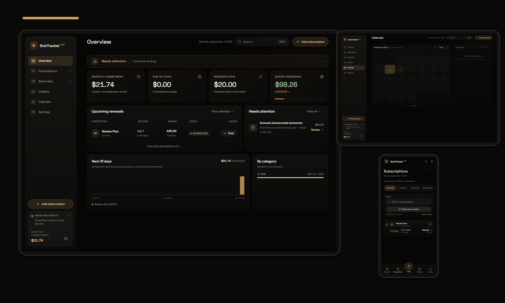
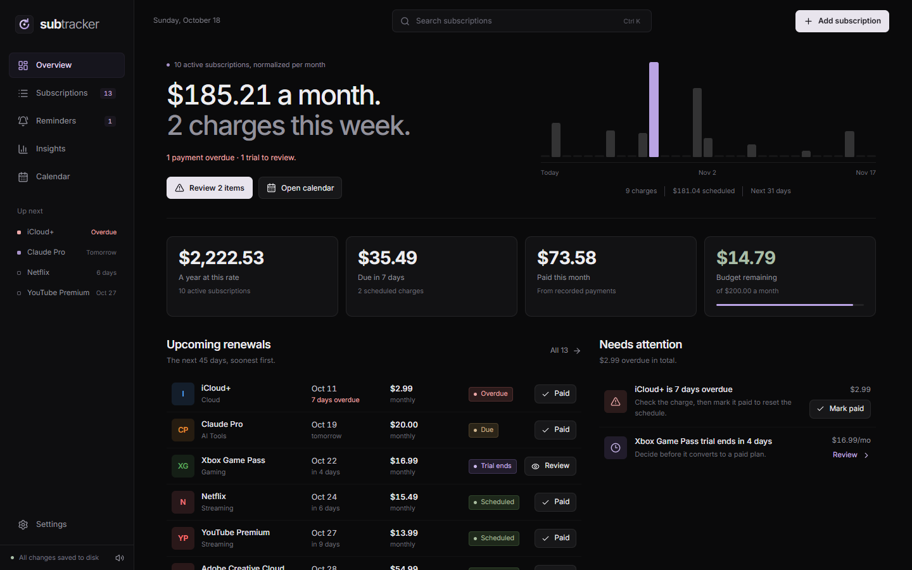
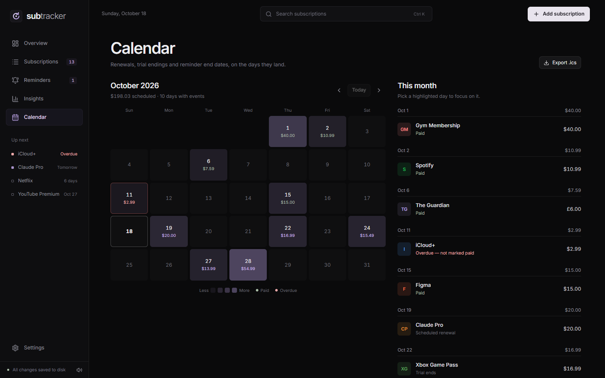
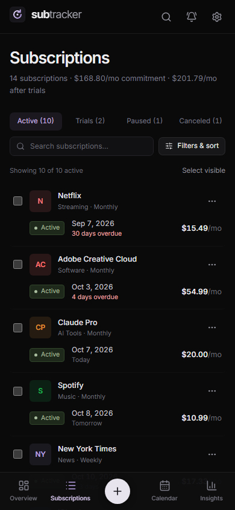

# SubTracker

A local-first subscription management app for tracking recurring bills,
upcoming renewals, one-time reminders, budgets, and payment history.



## Why this exists

A lot of subscription trackers are cloud-first, overcomplicated, or too loose
with personal finance data. SubTracker keeps things simple:

- your data stays on your own machine
- the app works offline
- subscription history and reminders are kept in a real file on disk
- recurring billing stays predictable even when you pay early or late

## Features

- **Recurring subscriptions** with monthly, weekly, yearly, quarterly,
  biweekly, and semiannual billing cycles
- **One-time reminders** for things like annual licenses, domains, prepaid
  plans, or trial endings
- **Payment history** with due-date tracking so early and late payments do not
  silently break the schedule
- **Budgeting and insights** for monthly commitment, recorded paid totals,
  upcoming spend, the plans that cost the most, and category breakdowns —
  past months come from what you actually paid, future months from the
  schedule
- **Imported data stays honest**: a date or price that came from an import
  and was never confirmed is shown as unverified, kept out of forecasts and
  alerts, and confirmed with one click
- **Calendar view** for billing dates and reminder end dates
- **Local-first persistence** with browser storage plus a real JSON data file
  on disk
- **Automatic recovery and backups** with previous-version snapshots and daily
  backup retention
- **Import/export tools** for full backup restore, additive import, CSV export,
  and calendar export
- **Responsive UI** for desktop and mobile
- **Keyboard shortcuts and search** for faster navigation
- **A calm, dark interface** — carbon surfaces, hairline borders and a single
  lavender accent, in the same visual language as Slate Music

## Screenshots

### Overview


The hero shows the monthly commitment and the next 31 days of scheduled
charges; the lists below are what is coming up and what needs a decision.

### Calendar


Past charges show whether they were paid or are still overdue; upcoming ones
are shaded by how much lands on the day.

### Mobile subscriptions view


## Tech stack

- React 19
- Vite 7
- Tailwind CSS 4 (design tokens and utilities; components are plain CSS in
  `src/index.css`)
- Motion is plain CSS (no animation library) — see `src/components/Presence.jsx`
- Inter, bundled with the app (`@fontsource-variable/inter`) — no font service
  is contacted and the type works offline
- Local Node.js server for disk-backed persistence

## Quick start

### 1. Install dependencies

```bash
npm install
```

### 2. Run the app

```bash
npm run app
```

That starts the local server at `http://localhost:5273`, rebuilding the app
first only if its files changed since the last start.

### Development mode

```bash
npm run dev
```

The Vite dev server runs at `http://127.0.0.1:5280`.

### Serve the production build without auto-opening the browser

```bash
npm run serve
```

## Windows launcher

If you want a double-click flow on Windows, use `launch.bat`.

It will:

1. check that Node.js is installed
2. rebuild the app only if its files changed (otherwise it opens at once)
3. start the local server
4. open the app in your browser

## Data and privacy

SubTracker is intentionally **local-first**.

Your data is saved to a real JSON file on disk:

```text
data/subtracker-data.json
```

Additional safety copies are kept as:

```text
data/subtracker-data.json.bak
data/backups/subtracker-YYYY-MM-DD.json
```

The local server binds to loopback only. It is designed for single-user local
use and does not expose a public network service.

## Demo data

A sample library is included here — fourteen records covering monthly and
yearly plans, a free trial, a paused and a canceled subscription, a shared
family plan, a second currency, a one-time reminder, and five months of
payment history:

```text
docs/demo-data/subtracker-demo-data.json
```

You can import or restore it from the Settings page if you want example data to
explore the UI.

## Available scripts

```bash
npm run dev      # Vite dev server
npm run build    # production build
npm run serve    # local Node server, no browser auto-open
npm run start    # local Node server with browser auto-open
npm run app      # start the real app (rebuilds only when needed)
npm run sandbox  # the app on port 5299 against a throwaway copy of your data
npm run lint     # ESLint
npm test         # Node test suite
npm run check    # lint + tests + build
```

## Project structure

```text
src/              React app source
public/           static assets (icon, manifest, service worker)
tests/            Node tests and browser-flow scripts
scripts/          launch helpers (build-if-changed, sandbox server)
server.mjs        local data server and backup logic
launch.bat        Windows launcher
```

## Roadmap ideas

- richer filtering and saved views
- clearer onboarding for reminders vs recurring plans
- optional analytics improvements
- optional packaging as a desktop app
- improved screenshot and seed-data tooling

## Contributing

See [CONTRIBUTING.md](CONTRIBUTING.md).

## Security

See [SECURITY.md](SECURITY.md).

## License

Released under the [MIT License](LICENSE).
